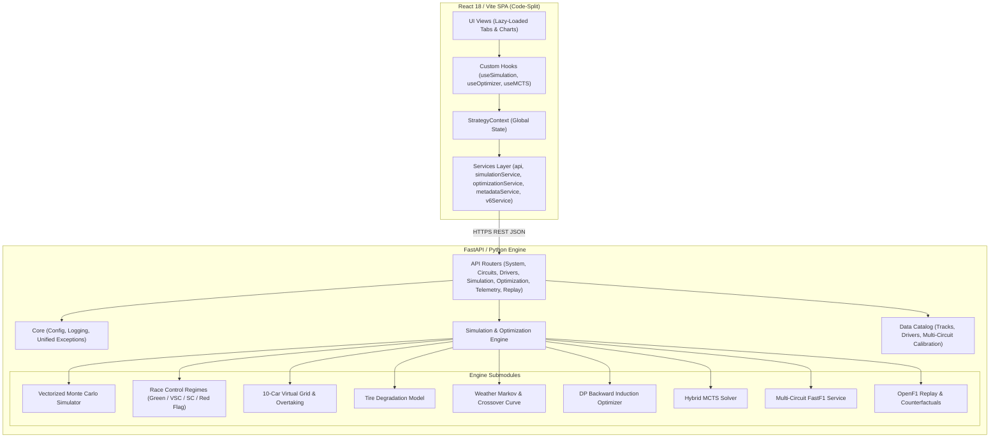

# 🏎️ Apex Strategy v6 — System Architecture & Design

This document details the modular system architecture, domain boundaries, data flow pipelines, and design patterns across **Apex Strategy v6**.

---

## 1. High-Level System Architecture



---

## 2. Directory Layout & Separation of Concerns

### Backend Architecture (`backend/app/`)

```
backend/
├── app/
│   ├── api/
│   │   ├── dependencies.py          # Track & driver parameter resolvers
│   │   └── routes/
│   │       ├── circuits.py          # /tracks endpoints
│   │       ├── drivers.py           # /drivers endpoints
│   │       ├── optimization.py      # /optimize and /optimize-mcts endpoints
│   │       ├── replay.py            # /replay/sessions, /replay/session/{id}, /replay/counterfactual
│   │       ├── simulation.py        # /simulate, /compare, /undercut-analysis, /simulate-grid, /weather/crossover
│   │       ├── system.py            # /, /health
│   │       └── telemetry.py         # /fastf1/calibrate?track_id=...
│   ├── core/
│   │   ├── config.py                # Centralized environment & logging setup (.env loader)
│   │   └── exceptions.py            # Typed domain, validation & HTTP exception handlers
│   ├── data/
│   │   ├── calibration_catalog.py   # Empirical baselines across all 5 circuits
│   │   ├── drivers.py               # Calibrated 2023 driver profiles
│   │   └── tracks.py                # Circuit presets, DRS zones & overtake difficulty
│   ├── engine/
│   │   ├── mcts/
│   │   │   ├── solver.py            # MCTSSolver, UCB1, adaptive refinement
│   │   │   └── state.py             # MCTSState, action transitions, rewards
│   │   ├── calibration_harness.py   # Heuristic vs ground-truth calibration
│   │   ├── dp_optimizer.py          # Dynamic Programming backward induction
│   │   ├── fastf1_service.py        # Multi-circuit FastF1 loader & offline cache
│   │   ├── heuristic_evaluator.py   # Decomposed interpretable leaf costs
│   │   ├── openf1_service.py        # OpenF1 historical sessions & MCTS counterfactuals
│   │   ├── race_control.py          # Green / VSC / Full SC / Red Flag regime matrix
│   │   ├── simulator.py             # NumPy-vectorized Monte Carlo engine
│   │   ├── tire_model.py            # Two-phase quadratic tire degradation
│   │   ├── virtual_grid.py          # 10-car virtual pack & DRS overtaking probability
│   │   └── weather.py               # Markov weather & slick/inter/wet crossover curves
│   ├── models/
│   │   ├── mcts.py                  # MCTS request/response schemas
│   │   ├── optimization.py          # DP optimization schemas
│   │   ├── strategy.py              # Strategy, VirtualGrid & ReplayCounterfactual schemas
│   │   ├── system.py                # Health & root response schemas
│   │   └── undercut.py              # Undercut curve schemas
│   └── main.py                      # FastAPI application factory & dual-mount routing
├── tests/                           # Organized pytest suite (54 tests)
├── scripts/                         # Benchmarking & driver profile utility scripts
├── pytest.ini                       # Pytest discovery & pythonpath configuration
├── main.py                          # Deployment entrypoint (Procfile / uvicorn main:app)
├── requirements.txt                 # Pinned dependencies with security patches
└── Procfile                         # Cloud process deployment
```

### Frontend Architecture (`frontend/src/`)

```
frontend/src/
├── config/
│   ├── constants.js                 # Strategy defaults, view tabs, compounds, MCTS modes
│   ├── constants.test.js            # Vitest config integrity tests
│   └── env.js                       # Environment variable access (API_BASE_URL)
├── context/
│   └── StrategyContext.jsx          # React state management for strategies/results
├── hooks/
│   ├── index.js                     # Central hook exports
│   ├── useMCTS.js                   # Mid-race MCTS replanning & live state hook
│   ├── useOptimizer.js              # DP optimizer hook
│   ├── useSimulation.js             # Monte Carlo simulation hook
│   └── useStrategyContext.js        # Safe context consumer hook
├── services/
│   ├── api.js                       # Centralized HTTP client (timeouts, errors)
│   ├── metadataService.js           # Track presets, drivers, telemetry cache
│   ├── optimizationService.js       # DP and MCTS API endpoints
│   ├── simulationService.js         # /simulate, /compare, /undercut-analysis
│   └── v6Service.js                 # Virtual Grid, Weather Crossover & OpenF1 Replay
├── utils/
│   ├── formatters.js                # Shared race duration & compound formatting helpers
│   ├── formatters.test.js           # Vitest formatter unit tests
│   └── index.js                     # Utility exports
├── components/
│   ├── common/                      # Shared UI components
│   │   ├── ColdStartOverlay.jsx     # Free-tier server wake-up modal
│   │   ├── DriverSelector.jsx       # Driver picker with teammate metrics
│   │   ├── ErrorBanner.jsx          # Dismissible alert banner
│   │   ├── ErrorBoundary.jsx        # React runtime error boundary with recovery
│   │   ├── FastF1Banner.jsx         # Empirical telemetry validation badge
│   │   ├── HeaderNav.jsx            # Top navigation header + Shareable URL button
│   │   ├── StatsBanner.jsx          # Percentiles, moments, win rate banner
│   │   └── TrackSelector.jsx        # Circuit preset selector cards
│   ├── strategy/                    # Strategy inputs & optimization
│   │   ├── AlternativesTable.jsx    # Ranked top alternative plans
│   │   ├── OptimizerPanel.jsx       # DP optimizer configuration
│   │   ├── StrategyForm.jsx         # Multi-stint + VSC/SC/Red Flag controls
│   │   └── UndercutPanel.jsx        # Undercut vs overcut battle setup card
│   ├── charts/                      # Lazy-loaded Recharts visualizers
│   │   ├── DriverImpactChart.jsx    # Driver pace delta comparison
│   │   ├── MCTSTreeChart.jsx        # Tree candidate branch visualizer
│   │   ├── ResultsChart.jsx         # Lap time distribution histogram
│   │   ├── StintTimeline.jsx        # Visual tire stint timeline bar
│   │   ├── UndercutChart.jsx        # Undercut win rate probability curve
│   │   ├── VirtualGridPanel.jsx     # 10-car pack finish distribution (P1-P10)
│   │   ├── WeatherCrossoverChart.jsx# Slick vs Inter vs Wet crossover curve
│   │   └── WeatherVarianceChart.jsx # Dry vs mixed weather distribution
│   └── simulator/                   # Real-time replanning & replay
│       ├── MCTSDiagnosticsPanel.jsx # Search iterations & trigger stats
│       ├── RaceSimulatorTab.jsx     # Mid-race MCTS replanner dashboard
│       └── ReplayTab.jsx            # OpenF1 historical replay & counterfactuals
├── App.jsx                          # Lazy-loaded layout coordinator + URL hydration
└── main.jsx                         # React DOM mount point
```

---

## 3. Key Design Patterns & Engineering Highlights

### Code-Splitting & Bundle Optimization
* Heavy Recharts views (`VirtualGridPanel`, `ReplayTab`, `WeatherCrossoverChart`, `ResultsChart`, etc.) are lazy-loaded via `React.lazy()` and `<Suspense>`.
* `vite.config.js` separates `react-vendor`, `charts`, and `icons` via `manualChunks`, keeping the initial `index.js` entry bundle at **40.42 kB** (`12.05 kB` gzip).

### Scalable API Structure & Unified Errors
* Dual-mount routing exposes every endpoint at root (`/simulate`, `/simulate-grid`, `/replay/sessions`) and `/api/v1/*`.
* Domain exceptions (`CircuitNotFoundError`, `InvalidStrategyParameterError`), Pydantic `RequestValidationError`, and HTTP exceptions all return `{status, error_type, detail, path}`.
